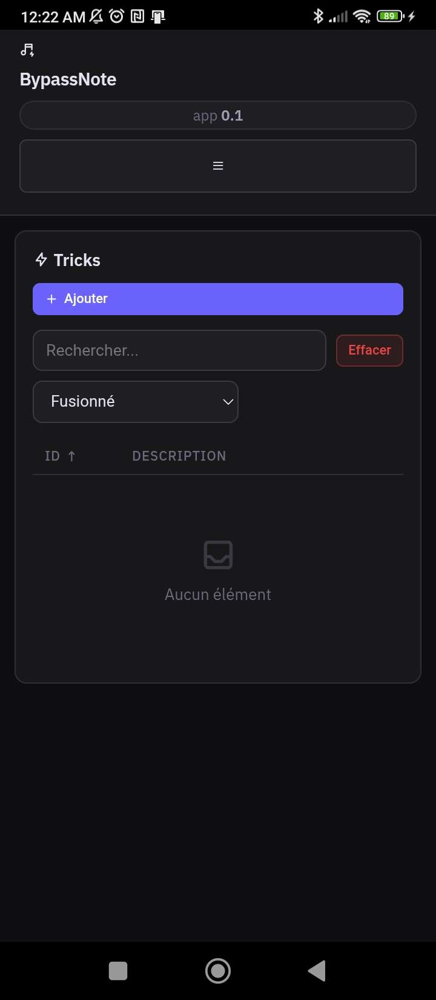
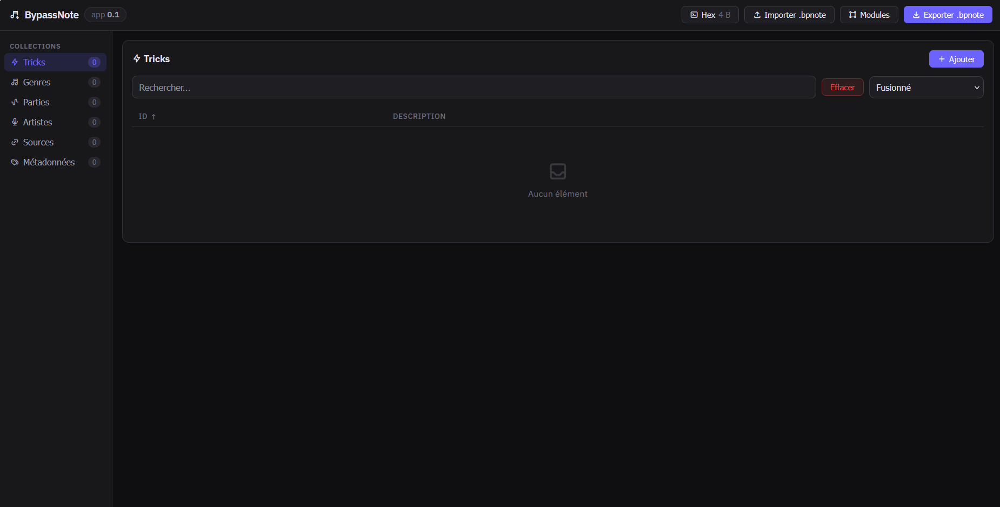

# BypassNote

<div align="center">
  
</div>

## Overview

<div align="center">
  
</div>



Application [Expo](https://expo.dev) (Expo Router + TypeScript), cible Android et web.

## Démarrer

```sh
npm install
npm run web      # serveur de dev web
npm run android  # dev Android
```

## Build web

```sh
npm run build:web
```

Le build est généré dans `dist/` et peut être hébergé tel quel sur un serveur
statique (Netlify, Vercel, Cloudflare Pages, GitHub Pages, Nginx...).

`app.json` configure `web.output: "single"` : une seule page HTML, le routage
(`/`, `/collection/tricks`, ...) est géré côté client. L'hébergeur doit donc
renvoyer `index.html` pour toute URL inconnue (fallback SPA).

- Netlify : `public/_redirects` avec `/*  /index.html  200`
- Vercel : `{"rewrites": [{"source": "/(.*)", "destination": "/index.html"}]}`
- Nginx : `try_files $uri $uri/ /index.html;`
- Cloudflare Pages : fallback SPA automatique

Pour un sous-répertoire (`user.github.io/BypassNote/`), ajoutez `baseUrl` dans
`app.json` puis reconstruisez :

```jsonc
"experiments": {
  "baseUrl": "/BypassNote/"
}
```

## Application desktop (Tauri)

Le projet peut aussi être empaqueté en application desktop avec Tauri v2.
Tauri utilise le build web Expo (`dist/`) comme frontend.

### Prérequis

- Rust 1.90 ou plus, installé avec `rustup`
- Node.js 20 ou plus
- Dépendances système : WebView2 (Windows), Xcode Command Line Tools (macOS), `libwebkit2gtk-4.1-dev`, `libayatana-appindicator3-dev`, `librsvg2-dev` et `patchelf` (Linux)

### Développement

```sh
npm install
npm run dev
```

`npm run dev` lance le serveur Expo web puis ouvre la fenêtre Tauri.

### Build

```sh
npm run build
```

Le build web est généré dans `dist/`, puis empaqueté par Tauri. Les installateurs sont écrits dans `src-tauri/target/release/bundle/` (`msi`/`nsis` sur Windows, `dmg`/`app` sur macOS, `appimage`/`deb` sur Linux).

### Structure desktop

```text
src-tauri/
  Cargo.toml
  build.rs
  tauri.conf.json
  capabilities/
  icons/
  src/main.rs
dist/                  # build Expo utilisé par Tauri
```

### Icônes

```sh
npm run icons
```

Les icônes sont générées depuis `assets/icon.png`.

La CI GitHub Actions vérifie le formatage Rust, Clippy et les tests, puis construit les installateurs Windows, macOS et Linux.

## Build Android (Capacitor)

Capacitor utilise le dossier `dist/` généré par `npm run build:web`.

```sh
npm run build:web
npx cap add android
npx cap sync android
npx capacitor-assets generate
npx cap sync android
```

Configurez le SDK Android avec `ANDROID_SDK_ROOT` :

```powershell
setx ANDROID_SDK_ROOT "C:\Users\<your-user>\AppData\Local\Android\Sdk"
```

Puis :

```sh
npx cap run android
npx cap build android
```

Raccourci : `npm run cap:sync` rebuild `dist/` puis lance `npx cap sync`.

## Sauvegarde automatique

L'état complet est enregistré dans un `.bpnote` de travail après chaque
modification (800 ms d'inactivité), puis restauré au lancement suivant.

- **Natif** : fichier `bypassnote-autosave.bpnote` dans le dossier documents de
  l'application (jamais partagé).
- **Web / Capacitor** : mêmes octets stockés dans IndexedDB sous le même nom,
  `expo-file-system` n'ayant pas d'implémentation web utilisable.

L'export explicite (menu **Exporter .bpnote**) reste indépendant : il peut ne
contenir qu'une sélection de lignes, alors que la sauvegarde automatique
conserve toujours toutes les données.

L'action **Réinitialiser** vide l'espace de travail et supprime ce brouillon
(confirmation demandée). Exportez d'abord si vous voulez conserver les données.

## Structure

- `src/app` — routes Expo Router (`collection/[id].tsx`)
- `src/components` — composants partagés
- `src/hooks` — hooks réutilisables
- `src/lib` — codec protobuf `.bpnote`, import/export, store React, modules
- `src/styles` — styles globaux et polices
- `assets` — icônes et images de l'app Expo

Les modules `.js` / `.zip` s'installent depuis **Modules** dans l'application.
